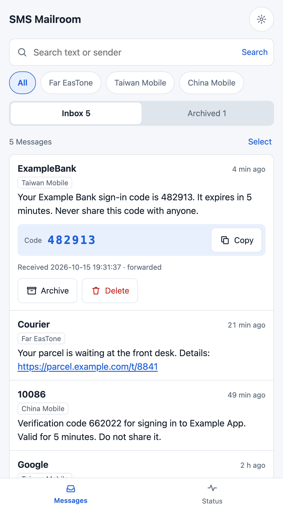
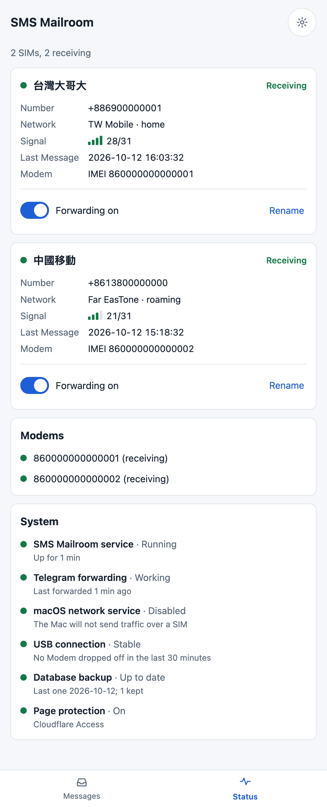
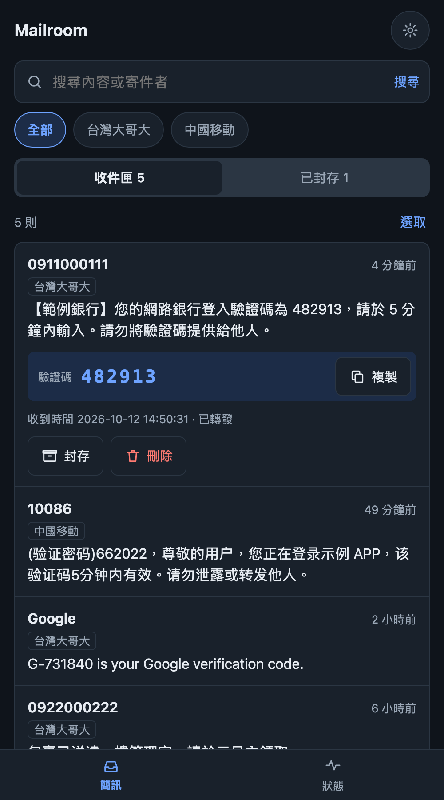

# Mailroom

[正體中文](./README.md) | English

Mailroom lets an always-on Mac receive your SMS for you. Put each SIM in a USB 4G modem; within seconds of arriving, a message is forwarded to your Telegram, and you can read and tidy your messages from anywhere through a web page.

It exists to fix one specific annoyance: a handful of SIMs kept only for verification codes, each sitting in a phone left at home, unreachable when you are out, with codes that expire in minutes.

<p>
  
  
  
</p>

## Features

- **Several SIMs at once**: one USB modem per SIM, and modems can be plugged in or pulled out while Mailroom runs.
- **Forwarding to Telegram**: every message is forwarded as it arrives, retried until Telegram accepts it, and never sent twice. Forwarding can be switched off per SIM.
- **Web interface**, built for a phone: search, filter by SIM, archive what is worth keeping, delete junk several at a time. A verification code in a message is shown on its own with a copy button.
- **Status at a glance**: each SIM's operator, roaming state and signal, and the state of the system itself.
- **Alerts**: when a SIM drops off the network, a modem disappears or keeps disconnecting, or Telegram is unreachable, you are told on Telegram, and told again when it is over.
- **Long messages reassembled**: an SMS the network split into parts becomes one message, even when the parts arrive out of order.
- **Traditional Chinese and English**, light and dark appearance.
- **Yours only**: the page is served on the loopback address, published through a Cloudflare Tunnel, and every request's Cloudflare Access token is verified.

## What you need

| Item | Notes |
|---|---|
| Computer | A Mac that stays on (developed and tested on Apple Silicon, macOS 27) |
| Modems | SIMCom **A7672G** USB modems, one per SIM. Other A76XX modules may work but are untested |
| USB hub | For more than one modem; give it its own power supply |
| Telegram bot | Receives the forwarded messages; create one with [@BotFather](https://t.me/BotFather) |
| Cloudflare account | With a domain on Cloudflare, for remote access through a Tunnel and Access |
| Software | [uv](https://docs.astral.sh/uv/), which installs the right Python for you |

Mailroom only receives SMS. It does not send messages, take calls, or use a SIM's mobile data.

## Quick start

```bash
git clone https://github.com/ccyanni/sms-mailroom.git
cd sms-mailroom
uv sync
uv run pytest        # the tests need no hardware
```

Once the tests pass, follow "Setting up from scratch" in the [runbook](./docs/runbook.en.md): create the Telegram bot, the Cloudflare Tunnel and the Access application, write the config file, disable the modems' macOS network service, and install the system service.

To try it locally first:

```bash
uv run python -m mailroom
```

Without Cloudflare Access configured, the page answers 403 to everything. For local development, add this to the config file:

```toml
[access]
allow_unauthenticated = true
```

Use it for development only. The page is served on `127.0.0.1`, but do not set this on a machine that already has the Tunnel pointing at it.

## Configuration

The config file lives at `~/Library/Application Support/Mailroom/config.toml`, outside this repository:

```toml
language = "zh"     # optional; "zh" or "en"

[telegram]
token = "<bot token>"
chat_id = "<your chat id>"

[access]
team_domain = "<team>.cloudflareaccess.com"
audience = "<the Access application's AUD tag>"

[alerts]
after_minutes = 3   # optional; how long a problem must last before you are told
```

## How it works

macOS has no driver for this modem, so no serial port appears. Mailroom talks to the modem's AT interface directly through libusb, with no driver to install and no root access. The details, and the traps found along the way, are in [ADR 0001](./docs/adr/0001-talk-to-modems-over-libusb.md). The most important one: the modem has two AT interfaces and both must be read at all times, or SMS in plain letters and digits silently never arrive.

The program is a single Python process: one thread per modem receives messages, SQLite stores them, and the page is FastAPI with server-rendered HTML and no front-end build step.

## Documentation

- [Runbook](./docs/runbook.en.md): installation, everyday operation, hardware notes
- [Glossary](./CONTEXT.md): what each term in the project means
- [ADRs](./docs/adr/): the significant technical decisions and why
- [Spec and tickets](./.scratch/mailroom/): the specification and tickets the project was built from

## Known limitations

- Tested only on macOS with the A7672G. Linux has a ready-made serial driver for these modems, but this project's USB layer was written for the macOS situation.
- A roaming SIM sometimes receives an SMS minutes late; that is the network's doing.
- A modem occasionally reports a read error, which is retried automatically; the cause is not yet known.
- Messages are stored unencrypted in the local SQLite database.

## How this was built

Almost all of the code, tests and documentation in this project were written by an AI (Anthropic's Claude) under the author's direction. The author supplied the requirements, made the design decisions, handled the hardware and verified the result on it.

What has been verified in practice: on one Mac mini, two A7672G modems with a Taiwan Mobile SIM and a roaming China Mobile SIM, receiving SMS, forwarding to Telegram, and signing in to the page through Cloudflare Access. The automated tests use a simulated modem and need no hardware.

This program handles verification codes. Review the code yourself before deploying it, in particular the three places that decide who gets in: `src/mailroom/access.py` (verifying the Cloudflare Access token), the middleware in `src/mailroom/web.py` that applies the check, and the settings in `src/mailroom/config.py` and `src/mailroom/__main__.py` that decide whether the check is on (`allow_unauthenticated`).

## License

[MIT](./LICENSE)
