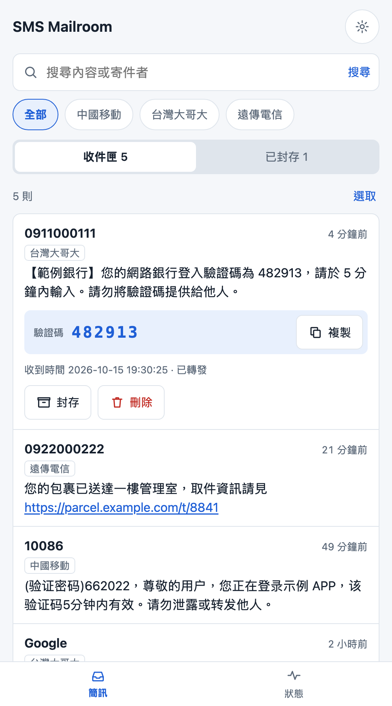
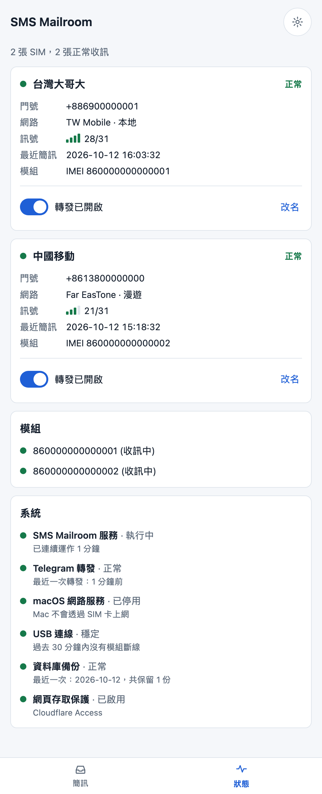

# Mailroom

正體中文 | [English](./README.en.md)

Mailroom 讓一台不關機的 Mac 替你收簡訊。把 SIM 卡插在 USB 4G 模組上，簡訊進來後幾秒內就會轉發到你的 Telegram，也可以從任何地方打開網頁查看和整理。

它是為了解決一個具體的麻煩：幾張只用來收驗證碼的 SIM 卡，原本各自插在一支留在家裡的手機上，人不在家就收不到，而驗證碼幾分鐘就過期。

<p>
  
  
  
</p>

## 功能

- **多張 SIM 同時收簡訊**：每張 SIM 插在一片 USB 模組上，模組可以在執行中隨時插拔。
- **轉發到 Telegram**：簡訊進來後立刻轉發；Telegram 連不上時會持續重試，不會重複發送。每張 SIM 可以個別開關轉發。
- **網頁介面**：以手機操作為主。搜尋、依 SIM 篩選、封存有用的簡訊、一次刪除多則垃圾訊息。簡訊裡的驗證碼會獨立顯示，並附上複製按鈕。
- **狀態一目了然**：每張 SIM 的業者、漫遊與否、訊號強度，以及系統本身的狀態。
- **異常通知**：SIM 掉出網路、模組不見、模組一直斷線、Telegram 中斷時，會發通知到 Telegram，恢復時再通知一次。
- **啟動通知**：服務每次啟動都會通知你，並說明是電腦剛重新開機，還是只有服務重啟。
- **每日備份**：資料庫每天自動備份一次，保留最近 14 天。
- **長簡訊重組**：被電信網路拆成多段的簡訊會合併成一則，段落順序顛倒也沒問題。
- **中文與英文介面**，淺色與深色外觀。
- **只有你能看**：網頁只在本機提供服務，對外經由 Cloudflare Tunnel，並驗證每個請求的 Cloudflare Access 憑證。

## 需要的東西

| 項目 | 說明 |
|---|---|
| 電腦 | 一台持續開機的 Mac（在 Apple Silicon、macOS 27 上開發與測試） |
| 模組 | SIMCom **A7672G** USB 模組，每張 SIM 一片。其他 A76XX 系列可能可用，但沒有測試過 |
| USB 集線器 | 接多片模組時使用，請接上獨立電源 |
| Telegram 機器人 | 用來接收轉發的簡訊，向 [@BotFather](https://t.me/BotFather) 申請 |
| Cloudflare 帳號 | 需要一個託管在 Cloudflare 的網域，用 Tunnel 和 Access 提供遠端存取 |
| 軟體 | [uv](https://docs.astral.sh/uv/)（會自動安裝所需的 Python） |

Mailroom 只收簡訊。它不發簡訊、不接電話，也不會使用 SIM 卡的行動數據。

## 注意：行動數據與漫遊費用

Mailroom 只收簡訊，本身不會使用行動數據。但模組連上電信網路後，會自動建立一條數據連線，而且**無法從 Mailroom 這一端關掉**：用 AT 指令切斷後，模組大約 20 秒內就會自己重新連上。

Mailroom 做了兩層防護，讓這條連線上不會有流量：

- 讓模組的 USB 網路共享維持關閉，電腦無法透過模組上網。
- 檢查 macOS 的網路服務「A76XX Series LTE Module」是否停用，一旦被啟用就發出異常通知。這個服務需要你在「系統設定 → 網路」手動停用一次。

即使如此，連線本身仍然存在，這個專案無法保證電信業者不會收費。**如果你的 SIM 卡會漫遊，請向電信業者關閉該門號的數據漫遊**，這是唯一能確實避免漫遊數據費用的做法，而且不影響收簡訊。

## 快速開始

```bash
git clone https://github.com/ccyanni/sms-mailroom.git
cd sms-mailroom
uv sync
uv run pytest        # 測試不需要任何硬體
```

測試全部通過後，依照[操作手冊](./docs/runbook.md)的「從零開始設定」完成七個步驟：建立 Telegram 機器人、建立 Cloudflare Tunnel 和 Access 應用程式、寫設定檔、停用 macOS 的模組網路服務、安裝成系統服務。

想先在本機試試看，可以直接執行：

```bash
uv run python -m mailroom
```

沒有設定 Cloudflare Access 時，網頁會對所有請求回應 403。本機開發可以在設定檔加上：

```toml
[access]
allow_unauthenticated = true
```

這個設定只應該用在開發。網頁只在 `127.0.0.1` 提供服務，但請不要在已經接上 Tunnel 的機器上使用它。

## 設定

設定檔放在 `~/Library/Application Support/Mailroom/config.toml`，不在這個 repo 裡：

```toml
language = "zh"     # 選填；"zh" 或 "en"

[telegram]
token = "<機器人 token>"
chat_id = "<你的聊天室 ID>"

[access]
team_domain = "<團隊名稱>.cloudflareaccess.com"
audience = "<Access 應用程式的 AUD 標籤>"

[alerts]
after_minutes = 3   # 選填；問題持續多久之後才通知

[backup]
keep = 14           # 選填；保留幾天的備份
```

## 運作方式

macOS 沒有這款模組的驅動程式，所以不會出現序列埠。Mailroom 改用 libusb 直接讀寫模組的 AT 介面，不需要安裝驅動程式，也不需要 root 權限。細節和踩過的坑記錄在 [ADR 0001](./docs/adr/0001-talk-to-modems-over-libusb.md)，其中最重要的一條是：模組有兩個 AT 介面，兩個都必須持續讀取，否則純英數字的簡訊會無聲無息地遺失。

程式本身是一個 Python 行程：每片模組一條執行緒負責收簡訊，資料存在 SQLite，網頁用 FastAPI 和伺服器端產生的 HTML，沒有前端建置步驟。

## 文件

- [操作手冊](./docs/runbook.md)：安裝、日常操作、硬體注意事項
- [詞彙表](./CONTEXT.md)：專案裡每個名詞的定義（英文）
- [ADR](./docs/adr/)：重要的技術決定和原因（英文）
- [規格與工單](./.scratch/mailroom/)：開發過程的規格書和工單（英文）

## 已知的限制

- 只在 macOS 和 A7672G 上測試過。Linux 有現成的序列埠驅動程式，但這個專案的 USB 層是針對 macOS 的情況寫的。
- 漫遊中的 SIM 有時會晚幾分鐘才收到簡訊，這是電信網路的行為。
- 模組偶爾會回報讀取錯誤，程式會自動重試；原因還不清楚。
- 簡訊內容以明文存在本機的 SQLite 資料庫裡。

## 待辦事項

還沒有做、之後可能會加的功能：

- [ ] 發簡訊
- [ ] 忘記一張 SIM：把不再使用的 SIM 從清單中移除

## 關於開發方式

這個專案的程式碼、測試和文件，絕大部分是由 AI（Anthropic 的 Claude）在作者的指示下撰寫的。作者負責需求、設計決定、硬體操作和實機驗證。

實際驗證過的範圍：在一台 Mac mini 上，以兩片 A7672G 模組搭配台灣大哥大和中國移動（漫遊）的 SIM 卡收簡訊、轉發到 Telegram，並透過 Cloudflare Access 登入網頁。自動化測試使用模擬的模組，不需要硬體。

這個程式會經手驗證碼簡訊。部署之前，請自行審閱程式碼，尤其是跟存取控制有關的三處：`src/mailroom/access.py`（驗證 Cloudflare Access 憑證）、`src/mailroom/web.py` 裡套用檢查的中介層，以及 `src/mailroom/config.py` 和 `src/mailroom/__main__.py` 裡決定是否啟用檢查的設定（`allow_unauthenticated`）。

## 授權

[MIT](./LICENSE)
